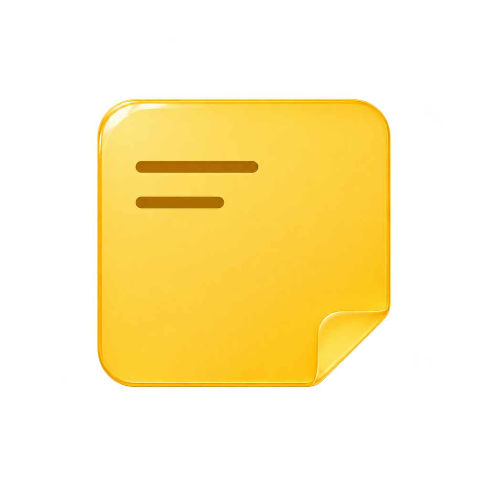
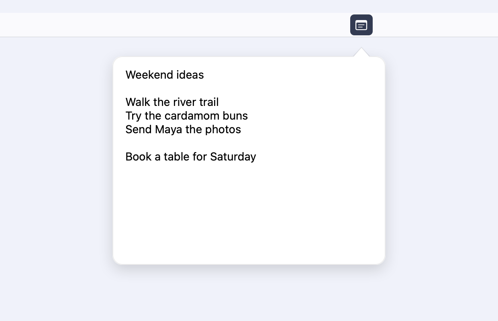

<p align="center">
  
</p>
<h1 align="center">Jot</h1>
<p align="center"><strong>One note, right in your Mac menu bar.</strong></p>
<p align="center">
  <strong><a href="https://github.com/zackbraksa/jot/releases/download/v1.0.1/Jot-1.0.1-macOS.dmg">Download Jot for macOS</a></strong><br>
  macOS 14 or later · Apple silicon and Intel
</p>

Open the disk image and drag **Jot** to **Applications**.



Use Jot for a thought you want to keep, a bit of text you need to paste again, or a draft you’ll come back to. Click the menu bar icon to open your note and press <kbd>Esc</kbd> to get back to what you were doing.

Jot saves as you type. Your note stays on your Mac as a plain-text file.

## Build from source

You’ll need Xcode 26 or later, Python 3, and Git to build from source.

```sh
git clone https://github.com/zackbraksa/jot.git
cd jot
./script/build_and_run.sh --build-only
open Jot.app
```

To install Jot in `/Applications` and launch it, run the script without `--build-only`.

## Updates

Right-click Jot’s menu bar icon and choose **Check for Updates…**. This release starts receiving updates through Sparkle. Install it manually if you use an earlier version.

## License

[MIT](LICENSE). Sparkle and its bundled components retain their own licenses, included in the app as `SPARKLE-LICENSE.txt`.
